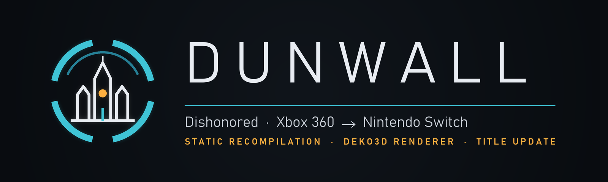
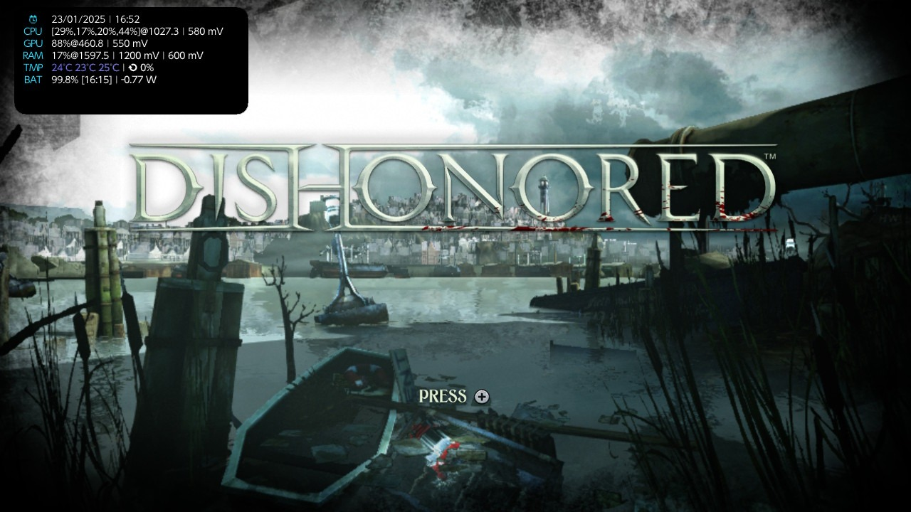
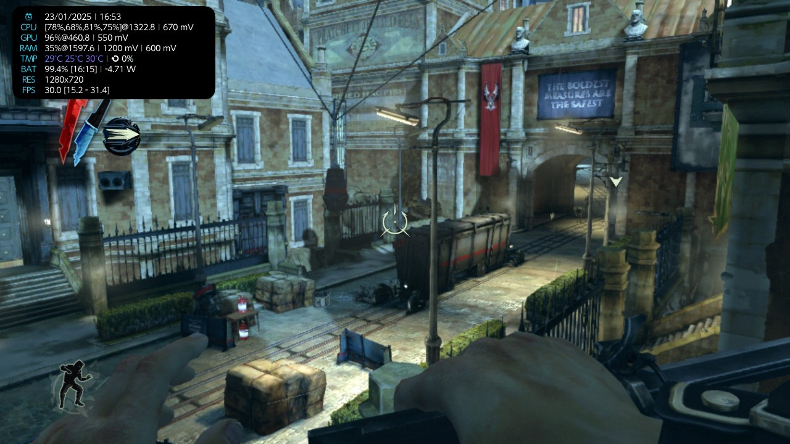
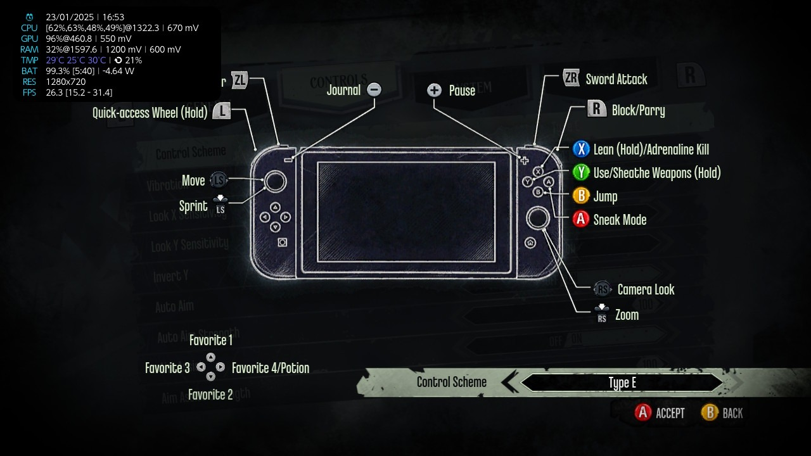
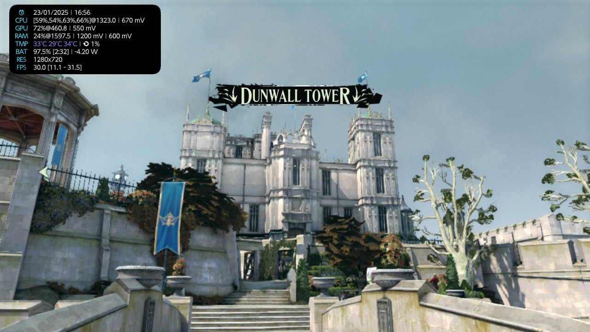
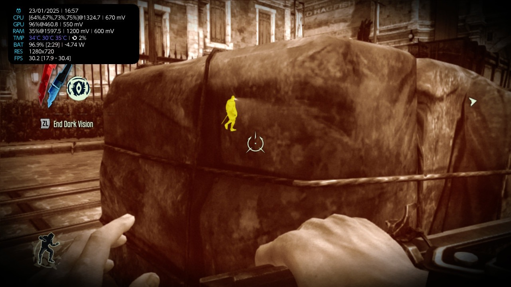
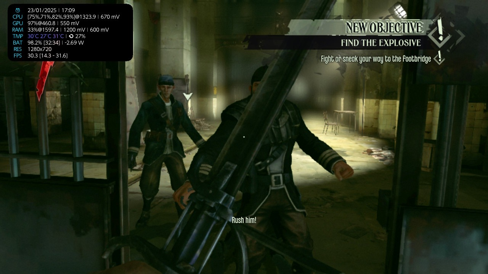

<div align="center">



### Arkane's *Dishonored* (Xbox 360, with its title update), statically recompiled for the Nintendo Switch

[](docs/install.md)
[](docs/architecture.md)
[-3fc4d6?style=for-the-badge)](docs/install.md)
[](docs/known-issues.md)
[](LICENSE)

**[What it is](#%EF%B8%8F-what-it-is)** · **[Known issues](#-known-issues-at-a-glance)** · **[Highlights](#-highlights)** ·
**[What we fixed](#-what-we-fixed)** · **[Screenshots](#%EF%B8%8F-screenshots)** · **[Editions](#-supported-editions)** ·
**[Install](#-install)** · **[Build](#%EF%B8%8F-building-from-source)** · **[Controls](#-controls)** · **[FAQ](#-faq)** ·
**[Story](#-how-it-came-together)** · **[Docs](#-documentation)** · **[Credits](#-credits)**

</div>

---

> [!IMPORTANT]
> **No game files are included, and none may ever be added.** Dunwall is made from **your own** Xbox 360 copy of
> *Dishonored* and its title update. The code generated from the game, the converted shaders and the finished NRO are
> all built on your computer from your files.

## 🗝️ What it is

Dunwall is the sister project of **[Lazarus](https://github.com/VibePorter/Lazarus)** (Mass Effect 2 for the Switch):
the same tree, retargeted to another Unreal Engine 3 game on a newer XDK.

- **Static recompilation.** The game's PowerPC program (`default.xex` + the title update's `default.xexp`) is
  translated to C++ by the [ReXGlue](https://github.com/rexglue/rexglue-sdk) code generator and compiled for the
  Switch's ARM CPU. No emulator runs at play time: the Xbox 360 kernel, file system, audio (Wwise on XMA) and input
  are provided by the SDK's runtime.
- **A Direct3D-level renderer on deko3d.** Instead of emulating the Xenos GPU, *Renut* hooks the game's own Direct3D
  calls (draws, shaders, render targets, resolves) and replays them through [plume](https://github.com/renderbag/plume)
  on deko3d, the Switch's native graphics API. The game's ~49,500 shaders are converted ahead of time
  (Xenos microcode → SPIR-V → GLSL → DKSH).
- **Game-specific work on top:** a CPU occlusion rasterizer that answers UE3's occlusion queries, size-based culling,
  native replacements for hot functions, PGO builds, Switch button prompts and a redrawn controller screen, a new
  control scheme, all DLC, and menu clean-ups for things a Switch does not have (see below).

It runs on a real Switch and in Ryujinx, and the same app builds for Windows for debugging. It is a work in progress:
read **[known issues](docs/known-issues.md)** before you start a long playthrough.

## 🚧 Known issues at a glance

> [!WARNING]
> - **Not a locked 30.** The busiest views drop to the low 20s:
>   UE3's own render thread (one core) is the limit there.
> - **Rainbow or black textures on distant objects** can still appear now and then on the console and stay until the
>   level is loaded again. Several causes were found and fixed; the last one is not confirmed gone.
> - **You build it yourself.** There is no download; the NRO and shader files are made from your own disc and title
>   update, and the build chain has not yet been re-run from a fresh clone.
> - **One edition tested:** the Eastern European disc (English / Russian / Polish / Czech / Hungarian).
> - **Picture trade-offs for speed:** the world depth prepass and the sun's dynamic shadows of characters are not
>   drawn, and small far props are culled earlier than on the Xbox. Each is one line in `dishonored.toml`.
> - **No online:** leaderboards and the DLC store are removed from the menus.
>
> The full list: **[docs/known-issues.md](docs/known-issues.md)**.

## ⚡ Highlights

<div align="center">

| | Feature | What it does |
| :---: | :--- | :--- |
| 🎨 | **Native deko3d renderer** | The game's Direct3D calls drawn by deko3d: no GPU emulation, no Vulkan driver in the NRO |
| 👁️ | **CPU occlusion rasterizer** | UE3's occlusion queries are answered from the frame's own occluders on a worker core, without waiting for the GPU; hidden primitives are also dropped before UE3 draws them |
| ✂️ | **Prepass skip and size culling** | The depth prepass (up to 45 % of the draws in heavy views) is not drawn; small far meshes are skipped by size |
| 🔥 | **Hot natives + PGO** | Hand-written C++ for hot guest functions (each checked against the original), profile-guided LTO builds |
| 🧩 | **Every shader ahead of time** | 49,514 shader containers found in the packages, including the ones the first scans missed |
| 🎮 | **Switch button prompts** | The game's Xbox button prompts replaced, and the options' controller picture redrawn as a Switch |
| 🔁 | **Control scheme "Type E"** | A new scheme in *Options → Controls*: Type A with the A and B actions exchanged |
| 🌍 | **Language choice** | English, Russian, Polish, Czech or Hungarian from one disc (`dh_language`); by default English, or Russian on a console set to Russian |
| 📦 | **All DLC, as asset packs** | The game and each DLC package mounted from one pack file instead of thousands of SD card files |
| 💾 | **Switch user saves** | With the NSP forwarder the game saves into the chosen Switch user's save data, with real dates |
| 🧹 | **Menus that fit a Switch** | No "install to hard drive" prompt, storage device row, DLC store button or leaderboards |

</div>

### 📊 Measured

Real Switch, handheld, 480p scene with a 720p HUD, GPU at its stock 460.8 MHz and the CPU at about 1323 MHz (the
overlay in the screenshots below): 30 fps in the street, at Dunwall Tower and in the fight shown. From the console
logs of the instrumented builds: about 25 fps over a 27-minute session, and 23-24 fps at the heaviest stationary
spots (about 760-870 draws a frame, UE3's render thread at 88-90 % of its core). No long session of the release
build has been logged yet. How to measure your own runs: **[docs/measuring.md](docs/measuring.md)**.

## 🔧 What we fixed

Every row was found in a console or Ryujinx log, a RenderDoc capture or a crash stack. The longer story of each is in
**[docs/porting-notes.md](docs/porting-notes.md)**.

<div align="center">

| | Problem | Cause | Result |
| :---: | :--- | :--- | :--- |
| 🟨 | Flat yellow / grey frames | The device-watch list was Mass Effect 2's: no draw's state was ever compared | the title screen renders |
| 🎨 | Wrong colours, then a green 3D picture on the Switch | `Resolve`'s slice argument read as a mip level; the 32x16 colour-grading target scaled with the scene; a 2D-array view made as one layer | colours as on the Xbox 360 |
| ✏️ | Thin bright outlines on every edge | The texture fetch's exponent adjust was ignored (the game's FXAA reads one image at three scales) | outlines gone |
| 🌪️ | Swirling, torn materials | The shader translator linked vertex outputs to pixel inputs by register; UE3 packs them by semantic | materials right |
| 🟩 | Green screen in Dark Vision, missing blink sphere | Thousands of shaders were never extracted (four scanner bugs: slack bytes after LZX chunks, fully compressed packages, ...) | +4,147 shaders, none missing |
| ⬛ | Black screen on a sword hit | The +5 exponent of 16-bit fixed-point resolves was dropped: three resolves at 1/32 each | the blur shows (the combat screenshot) |
| 💥 | "GPU timeout" crash at level loads | The GPU channel's 2,048-entry command ring ran full while the CPU was far ahead | the submit is retried: no crash |
| 🐀 | 3-7 fps for minutes when rats arrive | UE3's per-draw polygon offsets were part of the pipeline key: ~640 new pipelines every 10 s | depth bias is dynamic state |
| 🧑 | Characters popping in and out | Occlusion answers came from the GPU a frame late | the CPU rasterizer answers in time |
| 👻 | Dark Vision showed nobody behind walls | The primitive cull hid characters UE3 never queries | only primitives with static meshes are culled |
| 📉 | HUD dropping to scene resolution after water | A screen effect detoured the final pass through a small buffer | the UI pass is kept |
| ⏱️ | 30 s on a black screen at every start | 65,000 pipeline records loaded with a grow-and-free pattern | containers reserved up front (console timing still to be checked) |
| 📅 | Saves dated 1970 | The Switch's save data file system keeps no file times | times kept beside the saves |
| 🏆 | Crash on the Dunwall City Trials leaderboard | `XUserReadStats` returned success without results | empty results; the leaderboards are hidden |

</div>

## 🖼️ Screenshots

Captured on a real Switch (handheld, 1280x720, GPU 460.8 MHz, CPU about 1323 MHz). The overlay in the corner shows
the clocks and the frame rate.

<div align="center">

| | |
| :---: | :---: |
|  |  |
| **Title screen** | **Dunwall**, at 30 fps |
|  |  |
| **Options → Controls**: the Switch picture, Switch prompts and the new *Type E* scheme | **Dunwall Tower** |
|  |  |
| **Dark Vision**, with a ZL prompt | **Combat**: the game's blur around a sword fight, at 30 fps |

</div>

## ✅ Supported editions

Dunwall is built for the **Xbox 360** release (title ID `425307E3`) with its **title update**. The NRO must be built
from the same `default.xex` + `default.xexp` you play with.

<div align="center">

| Edition | Base `default.xex` | With the title update | Status |
| :--- | :---: | :---: | :--- |
| Eastern European disc (English, Russian, Polish, Czech, Hungarian) | 0.0.0.17 | 0.0.3.17 | ✅ played on console, in Ryujinx and on the PC build |
| Other discs, Game of the Year Edition, Games on Demand | | | ❔ not tested: another program means other addresses |
| Without the title update | 0.0.0.17 | | ❌ not supported (every hook uses the updated addresses) |

</div>

## 📦 Install

The full guide, with the SD card layout, Ryujinx and the forwarder, is **[docs/install.md](docs/install.md)**. In short:

1. **Build the NRO and its shader files from your game** ([building](#%EF%B8%8F-building-from-source)). There are no
   prebuilt downloads: every file that comes from the game has to be made from your own copy.
2. Pack the game folder (`tools/build_asset_pack.py`) and copy it, the title update and the build to
   `sdmc:/switch/dishonored/`.
3. Copy [`config/dishonored.toml`](config/dishonored.toml) next to the NRO.
4. Start `dishonored.nro` **with full memory** (hold **R** while starting a game), or install the
   [NSP forwarder](docs/forwarder.md), which also unlocks the 4th CPU core and Switch user saves.

```text
sdmc:/switch/dishonored/
  ├── dishonored.nro                 ← tools/nx/build_switch.sh
  ├── dishonored.toml                ← config/dishonored.toml
  ├── deko3d_glsl.bin                ← the game's shaders (from your game)
  ├── deko3d_shaders.bin (+ .idx)    ← precompiled shader variants (from your game)
  ├── game_root.nxpack (+ .nxidx)    ← your game, as one asset pack
  ├── update/                        ← the title update: default.xexp and DishonoredGame/
  └── dlc/                           ← (optional) one pack per DLC package
```

## 🛠️ Building from source

The step-by-step guide is **[docs/building.md](docs/building.md)**. The outline:

```sh
# 0. Source and the third-party libraries the repository does not carry
git clone https://github.com/VibePorter/Dunwall.git && cd Dunwall
python tools/fetch_thirdparty.py          # SDK libraries (ReXGlue v0.10.0 and its submodules)
python tools/fetch_app_thirdparty.py      # plume / XenosRecomp submodules (Vulkan headers, DXC, zstd, ...)

# 1. Windows: your game into assets/game_root, the title update into assets/update, the code generator,
#    the C++ of the game
powershell -File tools\codegen.ps1 -Flavor optimised

# 2. Windows + WSL: the game's shaders (Xenos -> SPIR-V -> GLSL / DKSH), see docs/building.md "Shaders"

# 3. WSL / Linux: the Switch NRO (devkitA64)
sudo bash tools/nx/setup_wsl.sh
SHADER_CACHE_CPP=... GLSL_DIR=... DKSH_DIR=... bash tools/nx/build_switch.sh
```

## 🎮 Controls

The game's Xbox layout maps to the Switch **by letter for A and B** and **by position for X and Y**, and the on-screen
prompts follow:

| Switch | Xbox 360 pad | | Switch | Xbox 360 pad |
| :--- | :--- | --- | :--- | :--- |
| **A** / **B** | A / B | | **L** / **R** | LB / RB |
| **Y** (left) | X (left) | | **ZL** / **ZR** | LT / RT |
| **X** (top) | Y (top) | | **+** / **−** | Start / Back |

*Options → Controls → Control Scheme* has the game's four schemes and a fifth, **Type E** (Type A with the A and B
actions exchanged). **L + R + D-pad up** opens the frame-rate overlay when `ui_dev_overlays = true`.

## ❓ FAQ

<details>
<summary><b>Where is the download?</b></summary>

There is none, and there will not be one with game content in it. The NRO contains code translated from the game,
and the shader files are made from the game's shaders, so you build both from your own copy
([docs/building.md](docs/building.md)).
</details>

<details>
<summary><b>Does it run on an unmodified Switch?</b></summary>

No. It is homebrew: you need a console running Atmosphère. The NSP forwarder also needs sigpatches.
</details>

<details>
<summary><b>Can I use the PC, PS3 or Definitive Edition files?</b></summary>

No. Dunwall is the Xbox 360 program, and it needs the Xbox 360 disc and its title update. Other versions have
different program code and data formats.
</details>

<details>
<summary><b>Does the DLC work?</b></summary>

Yes, from your own extracted packages ([docs/install.md](docs/install.md#dlc)); seven packages were tested,
including Dunwall City Trials. The Trials' online leaderboards are removed.
</details>

<details>
<summary><b>Which language will I get?</b></summary>

English, or Russian when the console is set to Russian. `dh_language` in `dishonored.toml` picks any language
your disc has: the Switch itself has no Polish, Czech or Hungarian setting
([docs/configuration.md](docs/configuration.md)).
</details>

<details>
<summary><b>Switch Lite / OLED / docked?</b></summary>

Any Switch that runs Atmosphère should work; it was tested on one console. Handheld renders the scene at 480p
and docked at 540p, both with a 720p HUD. Docked play at 540p has not been measured yet.
</details>

<details>
<summary><b>Should I play in Ryujinx?</b></summary>

Ryujinx is for testing and debugging. It runs the port, but colours can be wrong there (an unimplemented shader
instruction) and it needs one extra setting ([docs/install.md](docs/install.md#ryujinx)).
</details>

## 📜 How it came together

One week from the first line to a build that plays through. The full story: **[docs/timeline.md](docs/timeline.md)**.

- **8 Nov:** the Lazarus tree cloned and retargeted: codegen, all 35 Direct3D hooks matched, the PC build at the 3D
  menu with sound; the first picture bugs fixed; the first Switch NRO.
- **9 Nov:** language choice, DLC, Ryujinx (green screen, the command-ring kickoff), optimised codegen, real
  occlusion queries, the first console run.
- **10 Nov:** device watch, natives, the CPU occlusion rasterizer, Switch button prompts, the rat-swarm slowdown,
  save dates, renderer ports from naruto-nx.
- **11 Nov:** the controller screen and Type E, menu clean-ups, prepass skip, primitive culling, the game's own
  quality and ini settings from the toml.
- **12 Nov:** every shader found ahead of time; Dark Vision; start-up and Press Start stalls; PGO capture.
- **13 Nov:** the "GPU timeout" crash traced to the command ring; the long rainbow-texture hunt; leaderboards.
- **14 Nov:** the release build (PGO + LTO), DLC as asset packs, the sword-hit blur, the frame-rate overlay.

## 📚 Documentation

| Guide | |
| :--- | :--- |
| [install.md](docs/install.md) | SD card layout, game files, DLC, Ryujinx |
| [building.md](docs/building.md) | Everything from your disc to the NRO |
| [configuration.md](docs/configuration.md) | `dishonored.toml` and the settings worth knowing |
| [forwarder.md](docs/forwarder.md) | The HOME-menu NSP: 4th core, user saves |
| [architecture.md](docs/architecture.md) | How the port works, folder by folder |
| [porting-notes.md](docs/porting-notes.md) | What was found in the game and how each problem was solved |
| [d3d-map.md](docs/d3d-map.md) | The game's XDK Direct3D functions and device fields |
| [pgo.md](docs/pgo.md) | Profile-guided builds |
| [debugging.md](docs/debugging.md) | Logs, crash stacks, RenderDoc, Ryujinx |
| [measuring.md](docs/measuring.md) | The performance report and how to read it |
| [known-issues.md](docs/known-issues.md) | What does not work yet |
| [timeline.md](docs/timeline.md) | How the port came together, day by day |
| [lazarus-backports.md](docs/lazarus-backports.md) | Fixes found here that also apply to Lazarus |

## 🙏 Credits

Dunwall stands on the work of many people. Licenses and the exact files each project contributed:
**[THIRD_PARTY_NOTICES.md](THIRD_PARTY_NOTICES.md)** and **[UPSTREAM_SA2_NOTICES.md](UPSTREAM_SA2_NOTICES.md)**.

**The ports this one grew from**

- **[Lazarus](https://github.com/VibePorter/Lazarus)** (Mass Effect 2): the tree Dunwall started from, and everything
  it carries from the projects below
- **[mgr-nx-deko](https://github.com/tuancapoo/mgr-nx-deko)** by tuancapoo: the deko3d build, Renut retargeted to
  another game, the tooling around it, and the device layout of this XDK
- **[sa2-nx](https://github.com/ChanseyIsTheBest/sa2-nx)** by ChanseyIsTheBest: the renderer integration, the
  application structure and most of the build and analysis scripts
- **banjo-nx** by ChanseyIsTheBest (Banjo-Kazooie: Nuts & Bolts): Renut's deko3d tuning, plume's deko3d back end
- **[reNut](https://github.com/masterspike52/reNut)** by masterspike52: the Direct3D-level renderer itself
- **[masseffect-nx](https://github.com/nebadasSwifty/masseffect-nx)** by NebadasSwifty: the Unreal Engine 3
  recompilation base, the shader scanner, the CPU enhancement and native-function framework
- **[nfsmw-nx](https://github.com/StevensND/nfsmw-nx)** by StevensND: the SDK's Horizon (Switch) layer, the profiling
  and PGO method, the toolchain file and several scripts
- **[NFSMW Recompiled](https://github.com/madelrandel-blip/NFSMW-Recompiled)** by madelrandel-blip: the recompilation
  project the ports above started from

**Ports we learned from and borrowed fixes from**

- **[naruto-rise-of-a-ninja-nx](https://github.com/malinkin-s/naruto-rise-of-a-ninja-nx)** by malinkin-s: the alpha
  test as a pipeline constant, the lock-free render queue, repeated clears, the draw fast path, critical-section
  spinning
- **[Mass Effect Cinnamon](https://github.com/jvankooo/masseffect-cinnamon)** by jvankooo: this README's layout
- **[mk9-nx](https://github.com/Thorhax/mk9-nx)** by Thorhax: performance ideas (heap and deko3d memory tuning)
- **[ds2-nx](https://github.com/VasilkovND/ds2-nx)** by VasilkovND: XMA wake-up and thread yield fixes in the SDK
- **[prototype-switch](https://github.com/fungalspores/prototype-switch)** by fungalspores: the NSP forwarder packer
  and the codegen preparation step
- **Fruit Ninja NX**: the asset pack format
- **sasrt-nx**, **futari-nx**, **peggle2-nx** and **UnleashedRecomp-NX**: post-codegen passes, the frame latency
  probe, the HLSL front end and plume's Switch changes, as they reached us through sa2-nx and banjo-nx

**Recompilation and runtime**

- **[ReXGlue SDK](https://github.com/rexglue/rexglue-sdk)** by Tom Clay and contributors: the code generator and
  runtime
- **[Xenia](https://xenia.jp)** by Ben Vanik and the Xenia contributors, and
  **[xenia-canary](https://github.com/xenia-canary/xenia-canary)**: the Xbox 360 kernel and GPU knowledge in the SDK
- **[libnx](https://github.com/switchbrew/libnx)** (switchbrew) and **[devkitPro](https://devkitpro.org)**
  (devkitA64, newlib, the Switch portlibs)
- **[FFmpeg](https://ffmpeg.org)**: XMA audio decoding; **[libmspack](https://www.cabextract.org.uk/libmspack/)**
  by Stuart Caie: LZX decompression (the game's packages and its shader code cache)

**Graphics and shaders**

- **[plume](https://github.com/renderbag/plume)** by renderbag and contributors: the graphics API layer
  (deko3d, Vulkan, D3D12)
- **[deko3d](https://github.com/devkitPro/deko3d)** and **[uam](https://github.com/devkitPro/uam)** by fincs, with
  SwitchWakerHD's patches; Mesa's nouveau compiler inside uam
- **[XenosRecomp](https://github.com/hedge-dev/XenosRecomp)** by hedge-dev and contributors (and the reblue fork):
  Xenos shaders to HLSL / SPIR-V; **[UnleashedRecomp](https://github.com/hedge-dev/UnleashedRecomp)**, where much of
  this toolchain began
- **[DirectXShaderCompiler](https://github.com/microsoft/DirectXShaderCompiler)** (Microsoft, via
  [dxc-bin](https://github.com/renderbag/dxc-bin)), **[SPIRV-Cross](https://github.com/KhronosGroup/SPIRV-Cross)**,
  **[glslang](https://github.com/KhronosGroup/glslang)**, **[SPIRV-Tools](https://github.com/KhronosGroup/SPIRV-Tools)**
  and **[SPIRV-Headers](https://github.com/KhronosGroup/SPIRV-Headers)** (Khronos)
- **[smol-v](https://github.com/aras-p/smol-v)** by Aras Pranckevičius: SPIR-V compression
- **[FSR 1](https://github.com/GPUOpen-Effects/FidelityFX-FSR)** (AMD FidelityFX) and **FXAA 3.11** (NVIDIA): the final
  upscale and anti-aliasing
- **[Vulkan-Headers](https://github.com/KhronosGroup/Vulkan-Headers)**, **[volk](https://github.com/zeux/volk)** by
  Arseny Kapoulkine, **[Vulkan Memory Allocator](https://github.com/GPUOpen-LibrariesAndSDKs/VulkanMemoryAllocator)**
  and **[D3D12 Memory Allocator](https://github.com/GPUOpen-LibrariesAndSDKs/D3D12MemoryAllocator)** (AMD GPUOpen):
  the PC build's graphics back ends

**Libraries**

- **[fmt](https://github.com/fmtlib/fmt)**, **[spdlog](https://github.com/gabime/spdlog)**,
  **[toml++](https://github.com/marzer/tomlplusplus)**, **[CLI11](https://github.com/CLIUtils/CLI11)**,
  **[utfcpp](https://github.com/nemtrif/utfcpp)**
- **[xxHash](https://github.com/Cyan4973/xxHash)** by Yann Collet, **[Zstandard](https://github.com/facebook/zstd)**
  (Meta), **[SIMDe](https://github.com/simd-everywhere/simde)**, **[o1heap](https://github.com/pavel-kirienko/o1heap)**
  by Pavel Kirienko
- **[Dear ImGui](https://github.com/ocornut/imgui)** by Omar Cornut, **[stb](https://github.com/nothings/stb)** by
  Sean Barrett
- **[aes_128](https://github.com/openluopworld/aes_128)** by LuoPeng, **[tiny-AES-c](https://github.com/kokke/tiny-AES-c)**,
  disruptorplus, the RenderDoc API header, and the PowerPC disassembler shipped with ReXGlue
- PC build and tests only: **[SDL3](https://www.libsdl.org)**, **[MoltenVK](https://github.com/KhronosGroup/MoltenVK)**,
  the Vulkan loader, **[Catch2](https://github.com/catchorg/Catch2)**

**Tools and know-how**

- **[Forwarder-Mod](https://github.com/Skywalker25/Forwarder-Mod)** (nx-hbloader authors): the NSP forwarder's loader
- **Ryujinx**: testing without a console; **[RenderDoc](https://renderdoc.org)** by Baldur Karlsson: frame captures
  on the PC build and in Ryujinx
- **[Atmosphère](https://github.com/Atmosphere-NX/Atmosphere)**: running homebrew on the console

## ⚖️ Legal

Dunwall is an unofficial fan project, not affiliated with or endorsed by Arkane Studios, Bethesda Softworks, ZeniMax
Media, Microsoft or Nintendo. *Dishonored* is a trademark of ZeniMax Media Inc. You need your own legally obtained
copy of the game. The port's own code is GPL-3.0 ([LICENSE](LICENSE)); the SDK is BSD-3-Clause, and the third-party
parts keep their licenses ([THIRD_PARTY_NOTICES.md](THIRD_PARTY_NOTICES.md)).
